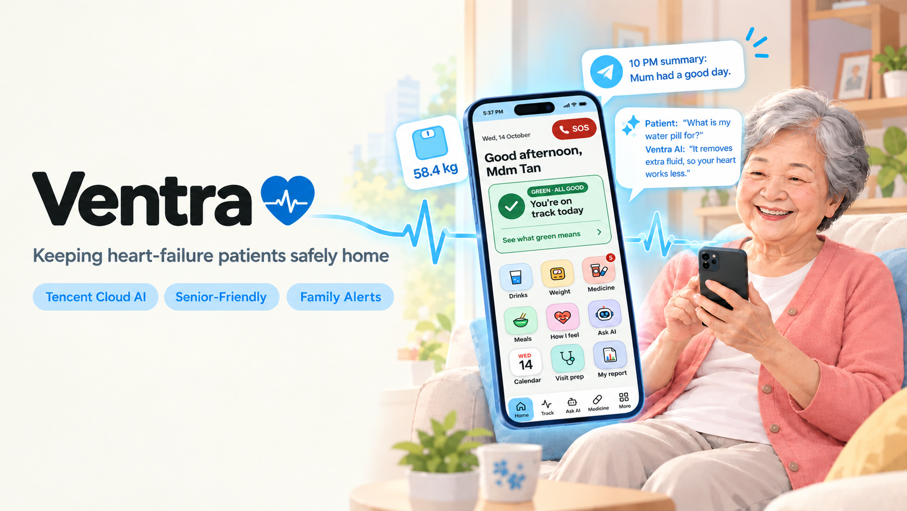
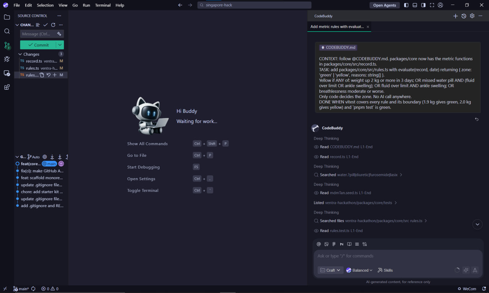
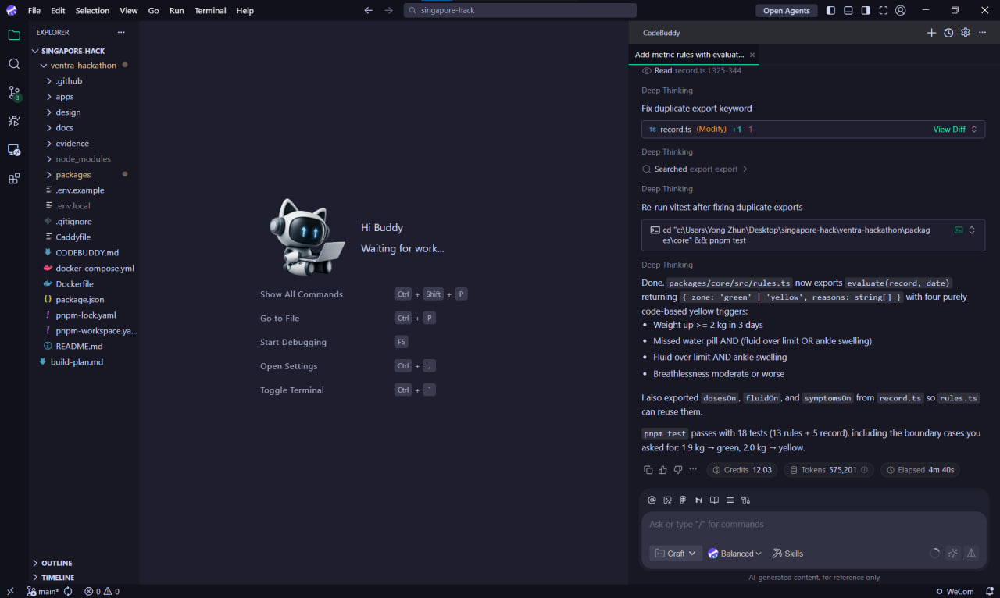
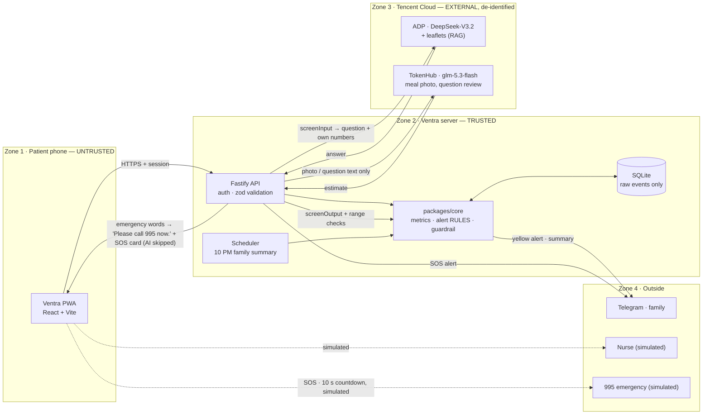

<div align="center">



<h1>Ventra</h1>

<h3>Safe, simple heart failure self-care companion.</h3>

<p><em>Heart Failure Self-Care Agent · Built for the Tencent Cloud "AI CAN DO IT" Hackathon Singapore 2026 · 
  Challenge 2: AI Healthier Every Day: Intelligent Support for Long-Term 
Self-Care</em></p>

<p>
  
  
  
  
  
  
  
  
  
</p>

<p>
  <a href="https://ventra-hackathon.onrender.com"><b>🚀 Live Demo</b></a> ·
  <a href="docs/architecture.md"><b>🧭 Architecture</b></a>
</p>

</div>

---

## The problem

**Older adults (65+) in Singapore who have just been discharged after a heart-failure hospital stay often end up back in hospital, because early warning signs at home are missed.**

- **20%** are readmitted within a year, the highest compared with OECD countries (average 11%) ([ACE, 2025](https://isomer-user-content.by.gov.sg/68/3edc195a-ee82-4033-8e5e-f320f9d4c123/ETPO016_2025_chfavbc.pdf)).
- Hospital costs for heart failure nearly doubled in 10 years, to **S$71.7M** in 2022 ([ACE, 2025](https://isomer-user-content.by.gov.sg/68/3edc195a-ee82-4033-8e5e-f320f9d4c123/ETPO016_2025_chfavbc.pdf)).

At home, patients must weigh themselves, take their medicines, and watch salt and fluids every day. For an older patient, this is hard to keep up. A slow weight gain goes unnoticed, and family and nurses often find out only after the patient is rushed to the emergency department.

**The gap:** no simple daily tool that older patients can use, and that warns family and the care team early.

## Target users

| Who | Need | How Ventra helps |
|---|---|---|
| **Older adults with heart failure** (main user) <br>65+, just home from hospital, e.g. Mdm Tan, 81 | Do the daily routine without confusion; know when to call for help | Big buttons, large text, voice input, one tap per task |
| **Family caregiver** <br>e.g. an adult child who lives apart | Know early if something is wrong | Telegram alert on a yellow day and a 10 PM daily summary |
| **Care team** <br>nurse, doctor | Clear information at the call or the visit | A nurse script and a one-page report built from the patient's logs |

## Built with

| Layer | Technology |
|---|---|
| **Frontend** | React 18, Vite, installable PWA, TanStack Query |
| **Backend** | Fastify, zod validation, TypeScript |
| **Database** | SQLite with Drizzle (raw events only) |
| **Shared logic** | `packages/core`: alert rules, metrics, guardrail (Vitest) |
| **AI** | Tencent Cloud ADP (DeepSeek-V3.2 + leaflets), TokenHub (glm-5.3-flash) |
| **Messaging** | Telegram Bot API |
| **Hosting** | Render (Docker, Singapore) |
| **Dev tool** | CodeBuddy |

## CodeBuddy proof

Ventra's foundation (scaffold, rules, database, API, login, CI and deploy) was built in **CodeBuddy IDE** sessions. We also used other AI coding assistants for some later features and fixes.

Three kinds of proof:

| Proof | What it shows | Link |
|---|---|---|
| **Usage log** (API call log) | 48 requests from CodeBuddyIDE, 758.57 credits, models kimi-k2.6, gpt-5.5, glm-5.2, minimax-m3 | [codebuddy-usage-log.xlsx](evidence/codebuddy-usage-log.xlsx) |
| **Chat screenshots** | 24 screenshots of CodeBuddy sessions, one per feature | [evidence/](evidence/README.md) |
| **Rules file** | The rules every CodeBuddy session followed (safety, patient scoping, accessibility) | [CODEBUDDY.md](CODEBUDDY.md) |

**How we prompted CodeBuddy:** one feature per session, always with the rules file attached.

```
@CODEBUDDY.md @<files>
CONTEXT: <what those files are>
TASK: <one feature, one sentence>
RULES: follow CODEBUDDY.md. <task-specific rule>
DONE WHEN: <testable criteria>
```

**Sessions with screenshots**

| What CodeBuddy built | Screenshot |
|---|---|
| Monorepo scaffold (app, server, core) | [view](evidence/D1-scaffold-a.png) |
| Patient record and metrics, with tests | [view](evidence/D1-core-port-a.png) |
| Alert rules (green / yellow), with tests | [view](evidence/D1-rules-a.png) |
| SQLite database, migration and demo data | [view](evidence/D1-db-a.png) |
| API contract and shared types | [view](evidence/D1-api-doc-a.png) |
| Design tokens and shared components | [view](evidence/D1-components-1a.png) |
| App shell, navigation and SOS button | [view](evidence/D1-shell-a.png) |
| Login with phone + PIN, patient scoping | [view](evidence/D2-auth-a.png) |
| Tencent Cloud ADP chat test script | [view](evidence/D1-codebuddy-adp-test.png) |
| CI fixes (GitHub Actions green) | [view](evidence/D1-fix-ci-1a.png) |
| Free-host deploy | [view](evidence/D1-deploy-a.png) |

<details>
<summary><b>Example: CodeBuddy building the alert rules</b> (click to open)</summary>




</details>

## The solution

Ventra is a phone app for older heart-failure patients (and a family member). Big buttons, one tap per task.

**Three ideas:**
1. **Rules decide, AI explains.** Green/yellow days come from tested code, never from an AI.
2. **Safety lives in code.** Every AI question and answer passes a guardrail. Dose questions are refused.
3. **Someone is told.** A yellow day gives the patient a nurse script and messages the family on Telegram.

## What it does

| Feature | In one line |
|---|---|
| **Home** | Green or yellow today, with a morning to-do (weigh · pills · how I feel) and dose reminders |
| **Drinks · Meals · Weight** | One tap per cap, salt against the daily limit, weight chart with a 2 kg-jump warning |
| **Scan my meal** | Photo → estimated sodium, fluid and a tip. Saved only after the patient confirms |
| **Medicine** | Today's pills with pictures. "I took it" is confirmed, then **locked**. **Scan a medicine box** explains it |
| **Ask AI** | Plain-English answers using the patient's own numbers. Voice input and read-aloud |
| **Yellow alert** | Reasons in plain words, a script to read to the nurse, Telegram message to family |
| **SOS** | On every screen: 10-second countdown with a big Cancel (simulated call) |
| **Doctor prep** | Questions to ask, trends since discharge, one-page report, visit calendar |

## Try this in 2 minutes

1. Open the [Live Demo](https://ventra-hackathon.onrender.com) and tap **Log in as demo patient**. Home is green.
2. **Ask AI**, try three questions:
   - "How much can I drink today?" → a real number from her own limit.
   - "Can I skip my water pill?" → a fixed refusal and a nurse card.
   - "I can't breathe" → "Please call 995 now."
3. **Track → Drinks:** log drinks past the limit. Then **How I feel:** tick swollen ankles. The day turns **yellow**, with a nurse script and a Telegram alert.
4. **Medicine:** confirm a pill. It locks and cannot be undone.
5. **SOS** → countdown → **Cancel**.

Voice input needs Chrome, Edge or Safari with the microphone allowed. The free host sleeps when idle, so the first load can take about a minute.

---

## Architecture and trust boundaries



| Boundary | What crosses | Protection |
|---|---|---|
| Phone → server | Logs, questions, photos | HTTPS, every request validated, rules re-run on every write |
| Server → AI | Question + today's numbers, or a photo | No name, phone, ID or medicines. Photo metadata stripped. Emergency and dose questions never reach the AI |
| AI → server | Free text | Never trusted: blocked if it gives dose advice, quotes sources or runs long. Fixed fallback line |
| Patient ↔ patient | Everything | Every query scoped to the session's `patient_id`; tests prove patient B can't read patient A |
| Server → family | Alerts, daily summary | One-time link code, secret-checked webhook; the patient chooses what else to share |

### Key trade-offs

| Decision | Chosen | Over | Why |
|---|---|---|---|
| Who decides alerts | Fixed rules in code | LLM judgement | Safe, testable, explainable to nurses |
| Safety enforcement | Code guardrail + prompt | Prompt only | We saw the model ignore fixed-line rules |
| Taken doses | Confirmed, then locked | Auto-taken / undo | No false adherence |
| AI context | Own numbers, no medicines | Question only | Real answers without steering toward dose advice |
| Meal logging | Photo estimate the patient confirms | Auto-logging | Vision can be wrong; the patient decides |
| App type | PWA on Render | Native app | One live link, one codebase |

More: [docs/architecture.md](docs/architecture.md) · [docs/api.md](docs/api.md) · [docs/prompts.md](docs/prompts.md)

## How prompts drive the AI

| Where | Prompt asks for | Code enforces |
|---|---|---|
| **Ask AI** (ADP) | Short plain-English explanations, never medicine advice | `screenInput` blocks emergencies and dose questions first; `screenOutput` blocks advice, source leaks, long answers |
| **Scan my meal** (TokenHub) | Food name, portion and nutrients as JSON | Every number range-checked; tip passes the guardrail; nothing logged until confirmed |
| **Doctor questions** (TokenHub) | Does this need the patient's doctor? If so, one short question | Must be one plain question, no links, no advice |

## Responsible AI

- **Fixed safety lines:** emergencies → "Please call 995 now." Dose, skip, stop or timing → "I can't advise on that. Please ask your pharmacist or doctor."
- **Honest when unsure:** blocked or failed answers → "I'm not able to answer that confidently." An unknown barcode says it doesn't know the box.
- **Humans decide:** scanned meals need confirmation; clinical questions go to the doctor list, not the AI.
- **Minimum data:** the AI never gets a name, phone number, ID or medicine list.
- **No false adherence:** a confirmed dose is locked and cannot be edited.
- **Tested:** the guardrail has 77 unit tests. Details: [docs/safety.md](docs/safety.md)

## Impact

### Business value

**Ventra helps hospitals keep heart-failure patients out of hospital after discharge, at very low cost.**

- **Problem cost:** heart-failure hospital stays cost **S$71.7M** in 2022, and **1 in 5** patients is readmitted within a year ([ACE, 2025](https://isomer-user-content.by.gov.sg/68/3edc195a-ee82-4033-8e5e-f320f9d4c123/ETPO016_2025_chfavbc.pdf)).
- **Proof the approach works:** a similar NHCS programme more than halved 30-day readmissions ([CHI](https://child.chi.sg/learn/child-collection/projects/to-reduce-the-readmission-rate-of-heart-failure-patients/)).
- **Ventra's edge:** the same kind of support, every day on the patient's own phone, with little extra staff time.
- **Next step:** a trial run with one clinic to measure weighing days, medicine adherence and readmissions.

| Who | Value |
|---|---|
| **Hospitals and MOH** (who pays) | Fewer readmissions: lower costs and more free beds |
| **Nurses and doctors** | Real data at each visit (one-page report, nurse script) instead of chasing patients |
| **Patients** | Stay home and stay well; one tap per task, plain explanations |
| **Family** | Know early when something is wrong, even living apart (Telegram alert, 10 PM summary) |

### The evidence

| What Ventra does | Published result |
|---|---|
| Explains medicines and warning signs, tracks daily self-care, alerts family | A similar NHCS programme (education, follow-up calls and an app) cut 30-day readmissions from **8.3% to 3.5%** and 6-month readmissions from **13.6% to 5.8%** ([CHI](https://child.chi.sg/learn/child-collection/projects/to-reduce-the-readmission-rate-of-heart-failure-patients/)) |
| Daily weighing | Patients who logged their weight on **≥ 80% of days** had **63% fewer** heart-failure hospitalisations ([Jones et al., 2014](https://pubmed.ncbi.nlm.nih.gov/24483776/)) |

### How we would prove it

A trial run with one clinic would measure these (Ventra already records all of them):

| Metric | How Ventra measures it | Goal in a trial run |
|---|---|---|
| Weighing days | Days with a morning weight logged | ≥ 80% of days |
| Medicine adherence | Confirmed doses ÷ doses due (confirmed doses only, locked once taken) | ≥ 80% of doses |
| Early warnings | Yellow days caught, and family alerted on Telegram the same day | Every yellow day |
| Readmissions | 30-day readmissions vs. the clinic's current rate | Lower than today |

**Practical to adopt:** one tap per task for the patient, no app store install, one container to deploy, and alert rules a clinic can read and change. Every AI feature fails safe: Ask AI falls back to fixed replies, meal scan to a manual list.

**Honest:** these are published results and trial goals. Ventra itself has **not** been tested in a clinical study yet.

---

## Run it locally

Node 22 and pnpm 9.

```bash
pnpm install
cp .env.example .env.local   # optional: ADP_KEY_GENERAL, TOKENHUB_API_KEY, TELEGRAM_*
pnpm dev                     # web :5173 · API :3000
pnpm test                    # 300+ tests: rules, guardrail, API scoping, screens
```

Every external service is optional: without keys, Ask AI gives only the fixed safety replies, meal scan is off, and family messages are off.

## Repository

```
ventra-hackathon/
├── apps/
│   ├── web/                 Patient app (React PWA)
│   │   └── src/
│   │       ├── pages/       One file per screen
│   │       ├── components/  Shared UI pieces
│   │       └── lib/         API hooks, voice, reminders
│   └── api/                 Server (Fastify)
│       ├── src/
│       │   ├── routes/      API endpoints
│       │   ├── services/    ADP, TokenHub, Telegram
│       │   └── db/          SQLite schema, seed
│       ├── drizzle/         Database migrations
│       └── tests/           API tests
├── packages/
│   └── core/                Shared by app and server
│       ├── src/rules.ts     Alert rules (green / yellow)
│       ├── src/guardrail.ts AI safety checks
│       └── tests/           Rules and guardrail tests
├── docs/                    API, architecture, safety, prompts
├── design/                  UI design screens
├── evidence/                CodeBuddy proof
├── .github/workflows/       CI
├── CODEBUDDY.md             Rules used in CodeBuddy sessions
└── Dockerfile               One container for app + server
```


